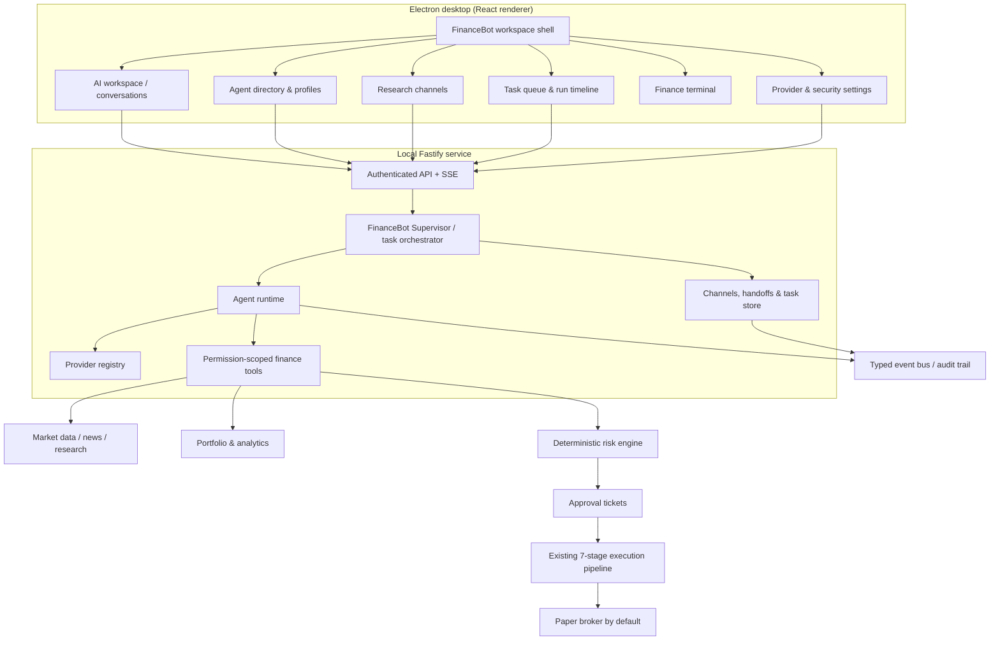

# FinanceBot Desktop Architecture

Status: proposed target architecture and implementation contract. This document describes how FinanceBot evolves the existing Finance Agent OS; it does not claim that every surface below is already implemented.

## Product intent

FinanceBot is a desktop-first workspace for a human-led financial research and trading team. It borrows the *interaction model* of persistent AI coworkers, workspaces, channels, task queues, handoffs, and model choice. It is not a general-purpose desktop automation clone.

The user remains the decision-maker. Agents can research, calculate, debate, draft strategy candidates, and prepare paper-trade proposals. The deterministic risk and execution pipeline remains the only route to order execution.

## Existing foundation to retain

- Electron + React 18 + Vite desktop application in `apps/dashboard`.
- Fastify API and SSE event stream in `apps/server`.
- `AgentRuntime`, `EngineManager`, `ProviderRegistry`, finance tool registry, and existing LLM provider adapters.
- Typed event bus, workflow orchestration, paper broker, kill switch, risk engine, HMAC approval tickets, and seven-stage execution pipeline.
- Existing agent/team and model-engine screens; FinanceBot should evolve these rather than fork a second dashboard.

## Target component architecture

### Trust boundaries

1. The renderer never receives provider secrets, exchange secrets, HMAC signing keys, or broker credentials.
2. Provider credentials are stored by the main process in the operating-system credential store (or injected through server environment variables for headless deployments). Never store plaintext secrets in renderer state, SQLite, agent prompts, logs, or source control.
3. Agent tools are allowlisted per agent and per task. Read-only research agents cannot call proposal or execution tools.
4. LLM output is untrusted input. A model cannot approve its own proposal, mint an approval ticket, modify risk limits, disable the kill switch, or call a broker directly.
5. Any order continues through the existing deterministic seven-stage execution pipeline and valid, unexpired HMAC-SHA256 risk approval ticket. Paper mode remains the default.
6. Live execution remains disabled unless the existing explicit environment gates and human approval process are satisfied.

## FinanceBot workspace information architecture

| Workspace | Responsibility |
| --- | --- |
| Home | Agent activity, queued work, market context and portfolio status |
| AI Workspace | User conversation with the Supervisor or a selected specialist |
| Agents | Agent identity, role, instructions, provider/model, allowed tools and memory scope |
| Channels | Persistent topic rooms such as `#market-briefing`, `#btc-research`, `#quant-lab`, `#risk-review` |
| Tasks | Durable task queue, assignment, dependencies, status, cancellation and result |
| Finance Terminal | Existing portfolio, charts, risk, paper orders, strategies and telemetry |
| Settings | Provider connections, model defaults, permissions, retention and security |

Agent profile fields: stable ID, display name, role, description, system instructions, provider ID, model ID, tool allowlist, execution permission, risk permissions, memory scope, status, and timestamps.

Suggested initial team:
- FinanceBot Supervisor — delegates work and synthesises evidence; advisory only.
- Market Analyst — price/volume/liquidity/news context; read-only.
- Quant Researcher — testable hypotheses, indicators and backtests; read-only until proposal permission is explicitly granted.
- Risk Guardian — independent challenge and risk review; read-only.
- Portfolio Manager — portfolio analytics and allocation analysis; advisory only.
- Execution Analyst — order construction and paper execution preparation; no direct broker access.
- Macro Economist — macroeconomic context; read-only.

## Agent collaboration and task lifecycle

A task is a durable unit of work, not just a chat message. Each task has an ID, creator, optional parent task, assigned agent, channel, priority, status, timestamps, cancellation state, input references, output references, and an audit trail.

Task states:
- `queued` → `running` → `completed`
- `running` → `waiting_for_agent` → `queued` (handoff)
- `queued` or `running` → `cancelled`
- `running` → `failed` (retry policy may enqueue a new attempt)

Handoffs create child tasks and explicit context packets. A child agent receives only the information and tool permissions needed for its assignment. The Supervisor waits for required child results, records timeouts/failures, and produces a synthesis with citations, data timestamps, assumptions, uncertainty, and dissenting views.

Channels are append-only collaboration streams with typed events (message, task-created, handoff, tool-result, approval-requested, task-completed). Avoid mutable shared prompt buffers. Every event records actor, task/run ID, timestamp, and references to source material.

## Runtime concurrency: migration requirement

The current `AgentRuntime` intentionally uses an exclusive execution lock: starting one agent run cancels other agents' in-flight runs. Do **not** simply delete `cancelOthers()` or change this behavior as a quick fix.

Before enabling concurrent coworkers, implement and test:
- Unique `runId` and `taskId` for every invocation.
- A run registry keyed by run ID, not just agent ID; multiple runs may belong to one agent.
- Per-run AbortController and external cancellation propagation.
- Per-run conversation history snapshots; no shared mutable message arrays.
- Tool execution context carrying actor, run ID, task ID, permissions, and abort signal.
- Idempotency keys for side-effecting operations.
- Per-agent and global concurrency limits, queueing, timeout, and backpressure.
- Cleanup in `finally`, including provider errors and client disconnects.
- Tests proving cancelling one run does not cancel another, including two simultaneous runs for the same agent.
- Updated `AGENTS.md` instructions only after the behavior and tests are in place.

The existing exclusive lock remains the safe behavior until this migration is complete.

## Multi-provider strategy

Use the existing `ProviderRegistry` / `EngineManager` abstraction as the single provider resolution layer. Do not wire SDK calls directly into React components or agent definitions.

Initial provider targets:
- OpenAI API (existing native adapter).
- OpenAI-compatible endpoints: OpenRouter, xAI, Google Gemini's compatible endpoint, LM Studio, vLLM and other compatible gateways where the provider's current API contract supports the required features.
- Ollama for local models (existing adapter).
- CLI adapters already supported by the project (Claude Code, Gemini CLI, Codex, Cline and other registered adapters).

Anthropic's native Messages API should use a dedicated server-side adapter or supported CLI route; do not pretend it is identical to the OpenAI Chat Completions API.

Per-agent provider/model selection should reference a registered engine ID and model ID. Provider health and model capabilities (tool calling, streaming, context size, vision) should be exposed through backend APIs. API keys must never be returned by provider-list or health endpoints.

## Persistence boundaries

Use the existing persistence patterns while the product foundation is introduced. Before channels and tasks become production features, add durable database models and migrations for:
- agents and versioned agent instructions;
- workspaces, channels, memberships and channel events;
- tasks, task dependencies, attempts and run events;
- provider connection metadata (never secret values);
- user preferences and memory references;
- audit events and approval references.

Use transactions for task state transitions. Keep large research artifacts in a file/object store with checksums and metadata; reference them from database rows. Apply existing secret sanitisation to logs, traces and memory.

## API and event contracts

Suggested API namespaces (implement incrementally):
- `/api/financebot/workspaces`
- `/api/financebot/agents`
- `/api/financebot/channels`
- `/api/financebot/tasks`
- `/api/financebot/runs/:runId`
- `/api/financebot/providers`
- `/api/financebot/events` (SSE)

All writes require schema validation and authorization. Task/run events should be typed and replayable using a cursor. Do not overload existing trade workflow endpoints for generic agent tasks.

## Desktop security

- Keep Electron `contextIsolation: true` and `nodeIntegration: false`.
- Expose only narrow, validated IPC methods through preload; no generic filesystem, shell, or arbitrary command bridge.
- Open external links in the system browser after URL validation.
- Keep API and provider secrets in the main process / OS credential store; renderer receives connection status only.
- Bind the local API to loopback by default and use a per-installation session token for desktop IPC/API access.
- Apply CSP, dependency review, signed releases and secure update practices before distribution.

## Acceptance criteria for the first usable release

- Desktop opens into a FinanceBot workspace, with the current Team and Terminal surfaces still reachable.
- User can inspect existing agents and model engines without losing current configuration.
- Provider settings show configured/unconfigured status without exposing secret values.
- A Supervisor task can be created, observed and cancelled with a unique task/run ID.
- Agent handoffs are visible and persisted; failed or cancelled work is not shown as successful.
- Specialist tool permissions are enforced server-side.
- No path from an LLM response directly to a broker exists; existing risk checks and approval gates remain mandatory.
