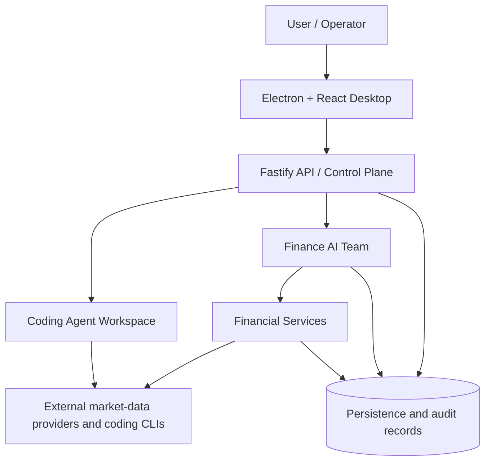
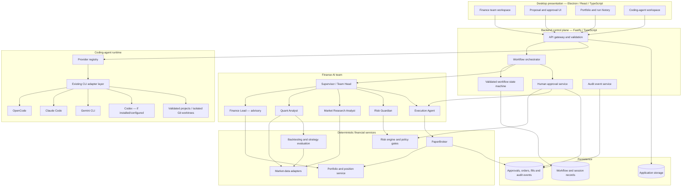
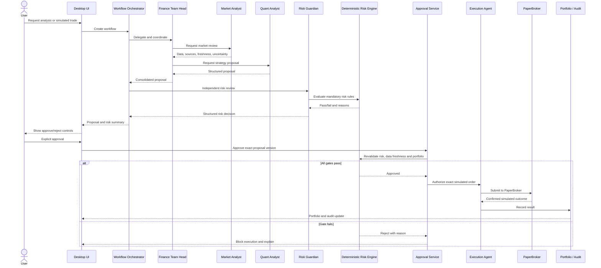

# Finance Agent OS — System Architecture

**Audience:** Engineering leadership, senior architects, reviewers  
**Status:** Architecture proposal aligned with the repository as inspected on 2026-10-24  
**Trading mode:** Paper trading only; no live brokerage execution is introduced by this document.

## 1. Executive summary

Finance Agent OS is a desktop-first finance workspace that coordinates specialized AI agents for market research, quantitative analysis, portfolio intelligence, risk review, and simulated execution. It also includes a coding-agent workspace that connects to supported coding CLIs through the existing adapter layer.

The design separates three concerns:

1. **AI reasoning:** research, analysis, planning, recommendations, and synthesis.
2. **Deterministic control plane:** request validation, workflow state, permissions, risk gates, approvals, simulated execution, and audit.
3. **Human supervision:** review, approval/rejection, project-change inspection, and operational visibility.

The core principle is: **AI agents propose and coordinate; deterministic backend services enforce policy and authorize actions.**

## 2. System context

This is a logical architecture. Individual paths and capabilities must be verified against the deployed environment and configured providers.

## 3. Finance AI team hierarchy

### AI Team Head / Supervisor

The Supervisor is the coordination role: it interprets the objective, creates tasks, delegates work, consolidates specialist findings, identifies conflicts, and communicates the result to the user.

It is **not** a privileged execution service. It cannot bypass server-side policy, approve a trade on behalf of the user, or submit an order directly.

### Specialists

| Role | Responsibility | Boundary |
|---|---|---|
| Finance Lead | Advisory portfolio context, treasury and capital-allocation analysis, executive summaries | Advisory-only; no trade proposal or execution permission by default |
| Quant Analyst | Strategy hypotheses, entry/exit conditions, assumptions and invalidation criteria | Produces structured proposals; does not approve its own risk |
| Market Research Analyst | Market conditions, data provenance, freshness and conflicting signals | Must distinguish observations from hypotheses |
| Risk Guardian | Independent review against configured limits and data-quality requirements | Missing/invalid mandatory information blocks the workflow |
| Execution Agent | Prepare and submit authorized simulated orders through PaperBroker | No direct live-broker access; cannot bypass approval |
| Coding Agent Manager | Manage coding-agent sessions, projects, streaming, cancellation and code review | Separate permission boundary from finance execution |

The AI Team Head delegates work, but the workflow orchestrator—not the model—owns state transitions and permission enforcement.

## 4. Logical component architecture

The diagram shows logical responsibilities, not a claim that every box is a separate deployed process. Existing modules should be reused rather than duplicated.

## 5. Paper-trading sequence

### Required safety invariants

- Paper trading is the only enabled execution mode in this scope.
- A language-model response cannot authorize an order.
- User approval is bound to the exact proposal version and order parameters.
- Recheck portfolio state, risk limits and market-data freshness immediately before simulated submission.
- Missing or failed mandatory checks block execution.
- Retries must not create duplicate simulated orders.
- Portfolio changes only from confirmed PaperBroker outcomes.
- Every important transition and terminal outcome is auditable.

## 6. Coding-agent workspace

The coding workspace is layered over the existing CLI adapter infrastructure; it should not create a second competing adapter system.

Logical flow:

1. Discover configured/installed providers and report actual availability.
2. Validate the selected project path.
3. Create a provider-specific session tied to one project.
4. Stream output and terminal events to the UI.
5. Support cancellation and explicit capability reporting.
6. Use isolated Git worktrees for parallel sessions where possible.
7. Show diffs and changed files for review.
8. Persist session metadata without storing credentials or secret environment values.

Provider targets include OpenCode, Claude Code, Gemini CLI, and Codex when installed and configured. Availability is environment-dependent; registration is not proof that a provider can complete a live task.

### Current known limitations

- The coding workspace's current adapters do not provide a common interactive permission channel; the permissions endpoint reports unsupported capability.
- Provider-specific model enumeration is not implemented by the current adapter contract.
- Claude Code's documented live-turn test was blocked by an invalid configured model; fix the configuration and verify a live turn before claiming end-to-end support.
- OpenCode can exceed a model's tool limit when user-level MCP servers expose too many tools; use a scoped configuration rather than silently modifying the user's global settings.

## 7. Persistence and observability

Use the repository's existing persistence conventions. Persist as applicable:

- Workflow ID, owner/initiator, current state, timestamps and transition history.
- Agent task IDs, structured results, errors and provenance.
- Proposal version, risk decision, approval/rejection record.
- Simulated order ID, confirmed fills, fees/slippage where supported and portfolio changes.
- Coding provider/session IDs, project references, cancellation and exit status.
- Audit events for approvals, rejections, submissions and failures.

Do not persist API keys, credential values or unnecessary sensitive prompt contents in audit records. Never record a fill unless PaperBroker confirms it.

## 8. Failure handling

- **Provider unavailable:** return a clear status and allow independent work to continue.
- **Market data stale or missing:** block or pause risk-sensitive execution according to policy.
- **Agent output invalid:** validate schema; reject or retry under bounded policy.
- **Risk rejection:** terminate the execution path with recorded reasons.
- **User rejection/cancellation:** no order is submitted.
- **Duplicate request:** use idempotency to avoid duplicate simulated orders.
- **Process timeout:** terminate safely, persist the failure, and allow a controlled retry.
- **Persistence failure:** do not claim the workflow is durably complete.
- **Concurrent coding sessions:** prevent shared-working-tree races or use isolated worktrees.

## 9. Implementation status and roadmap

### Existing foundation, as documented in the repository on 2026-10-24

- Electron/React desktop UI and Fastify/TypeScript backend.
- Finance team workspace and specialist runtime roles.
- Market-data, portfolio, risk and PaperBroker components.
- Coding workspace with provider discovery, sessions, streaming, cancellation, project validation, diff review and isolated worktrees.
- CI/test hardening for market-data tests that previously relied on live external requests.

### Remaining engineering priorities

1. **Stabilize provider support:** correct Claude model configuration and verify live tasks through each installed provider.
2. **Model selection:** add provider-specific model discovery where supported, with explicit unsupported states elsewhere.
3. **Permission UX:** design adapter-level permission requests before removing automatic tool approval where applicable.
4. **Finance workflow integration:** verify the complete proposal → independent risk check → explicit approval → final recheck → PaperBroker → portfolio update path with end-to-end tests.
5. **Persistence verification:** confirm workflow and audit recovery after application restart.
6. **Observability and security:** verify authorization boundaries, idempotency, cancellation, secret redaction and failure recovery.

Status should be updated only from fresh builds, tests and live integration checks; this document is not a substitute for CI evidence.

## 10. Architecture acceptance criteria

Engineering sign-off requires:

- Desktop build and type checks pass.
- Relevant automated tests pass with deterministic fixtures for unit tests.
- Finance Team Head delegates through a real orchestrator.
- Agent outputs are validated and traceable.
- Risk rejection and user rejection demonstrably prevent order submission.
- A successful simulation records a confirmed PaperBroker result and consistent portfolio update.
- Workflow and audit history survive restart.
- Coding providers report actual capability and failure status.
- Existing finance routes and workflows remain functional.
- No live trading is enabled.

## 11. Design decisions for review

1. Keep the AI Team Head advisory and coordinative; enforce execution in deterministic services.
2. Reuse existing backend modules and adapters rather than duplicating providers or financial logic.
3. Treat coding-agent execution and finance execution as separate permission domains.
4. Require human approval for simulated trades and sensitive coding actions where supported.
5. Make the workflow state machine, audit trail, and failure paths first-class components.
6. Ship provider integrations incrementally, with verified capability reporting.

## 12. Conclusion

Finance Agent OS is designed as a supervised, multi-agent finance platform with a parallel coding-agent workspace. The AI Team Head coordinates specialist reasoning, while backend services retain authority over risk, approval, execution and audit. This separation enables provider extensibility without sacrificing traceability or financial safety.
